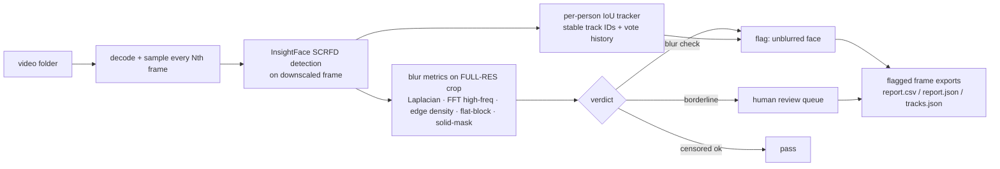

<div align="center">

# VeilAudit

**Offline audit pipeline that finds improperly censored (unblurred) faces in video.**

*Because a failed redaction is worse than no redaction at all.*

[](https://github.com/emalinow-ctrl/veilaudit/actions/workflows/ci.yml)
[](LICENSE)
[](pyproject.toml)
[](#privacy)

</div>

---

Redaction pipelines fail. Blur corners get cut, pixelation passes on a downscaled
check, black bars don't cover motion, and a single sharp frame of an identifiable
face survives an otherwise careful censorship pass. **VeilAudit watches the watcher**:
it scans folders of video locally, finds every face, and flags the ones a censoring
pass failed to actually censor — per person, across time, with evidence frames and a
full audit report.

Everything runs on your machine. No cloud APIs, no content filters, no data leaves
the box. After the one-time model download the machine can be air-gapped.

## Why not just check "is it blurry"?

Because naive intuition fails on real footage (see [`blurcheck.py`](blurcheck.py)):

| trap | what naive checks miss |
|---|---|
| **motion blur vs censor blur** | a moving *sharp* face scores like a blurred one on a single frame |
| **pixelation** | pixelated faces have *high* edge energy — they pass "is it sharp?" checks |
| **the neighbour problem** | an unblurred face next to a blurred one inherits its verdict without per-person tracking |
| **downscaled checks** | blur measured on a 640px detection frame disappears; VeilAudit always measures on the native-res crop |
| **black-box censor bars** | look like "no face" to naive checks; VeilAudit treats solid masks as censored-by-design failures |

## How it works



1. **Decode** each video with OpenCV, sampling every Nth frame (configurable).
2. **Detect** faces with InsightFace's SCRFD (`buffalo_l`, ONNX Runtime, CPU or CUDA).
3. **Judge** each face on the **full-resolution** crop: Laplacian variance, FFT
   high-frequency ratio, edge density, flat-block fraction (pixelation) and a
   solid-mask check (black bars / stickers).
4. **Track** every distinct person with a stable ID (`tracker.py`) and their own
   sharp/blurred vote history — a person is flagged only after failing in
   `min_fail_frames` of their recent sampled frames, so motion blur can't condemn
   someone on one frame and a blurred neighbour can't mask an unblurred face.
5. **Ask a human** when unsure: borderline faces land in a review queue
   (`review_server.py`) instead of being silently guessed.
6. **Export** only flagged frames (red boxes + track IDs) plus `report.csv`,
   `report.json` and per-person `<video>_tracks.json`.
7. **Checkpoint** every video's position to SQLite — Ctrl-C or crash resumes cleanly.

## Benchmarks

Synthetic ground-truth suite: procedurally composited actors with *known* blur
schedules (blur → sharp → blur, weak censoring, pixelation), scored against the
ground truth with [`tests/evaluate.py`](tests/evaluate.py).

| suite | event recall | weak-censor coverage | false-positive frames |
|---|---|---|---|
| full fixture (2 × 45 s, 12 actors) | **87.5 %** (7/8) | **100 %** (2/2) | **0** |
| tiny CI smoke (12 s, 2 actors) | **100 %** (2/2) | — | **0** |

Uncertain calls are routed to review rather than guessed — every number above
ships with its human-review load shown in `stats.json`.

## Quickstart

```bash
git clone https://github.com/emalinow-ctrl/veilaudit
cd veilaudit
python -m venv .venv && source .venv/bin/activate
pip install -r requirements.txt

# first run downloads the InsightFace pack once (~300 MB → ~/.insightface)
python main.py --input-dir /data/videos --output-dir /data/audit_out --workers 4
```

Or as a library / CLI (after `pip install .`):

```bash
veilaudit --input-dir /data/videos --output-dir /data/audit_out
```

### Calibrate first

Blur thresholds depend on source quality — don't trust the defaults blindly:

```bash
python calibrate.py --video /data/videos/sample.mp4 --out calib_out --max-faces 400
```

Eyeball the dumped face crops, find the Laplacian / HF-ratio values that separate
blurred from sharp *on your footage*, and set them in `config.yaml`.

### Tune automatically

```bash
python learn.py tune --report /data/audit_out/report.json
```

## The review loop

The pipeline doesn't guess when it's unsure. Borderline faces queue for human
review (`review_server.py`, port 8471); accepted/denied labels feed
[`learn.py`](learn.py), which tunes thresholds and trains an optional MobileNetV3
classifier tiebreaker (`train_classifier.py`) that is promoted to the default path
once it beats the heuristic F1. Label → retrain → redeploy, offline.

## Demo in 15 minutes

```bash
# 1. synthetic fixtures are committed — run the audit on them
python main.py --config tests/test_config.yaml --input-dir testdata/videos -o demo_out

# 2. score against the committed ground truth
python tests/evaluate.py --gt testdata/ground_truth --out demo_out --review-db demo_out/review.sqlite

# 3. look at the flagged frames
open demo_out/            # red boxes = censorship failures, with track IDs
```

## Privacy

- **100 % offline.** One-time model download, then air-gap-friendly.
- **Evidence frames only.** Exports contain flagged frames — faces the censoring
  *failed* to protect — never full-video dumps.
- **Your videos never leave the machine.** No telemetry, no accounts, no APIs.
- Test fixtures are synthetic; user footage is gitignored by policy.

## Project layout

```
main.py            pipeline entry point (parallel per-video workers, resume)
detector.py        SCRFD wrapper + learned face-confidence
blurcheck.py       the blur/pixelation/mask metrics (the heart of the audit)
tracker.py         per-person IoU tracker with verdict vote history
exporter.py        flagged-frame exports + reports
review_*.py        human review queue (SQLite + local web UI)
learn.py           threshold tuning + review-label learning
calibrate.py       dump face crops for manual threshold calibration
train_classifier.py optional MobileNetV3 tiebreaker
tests/             synthetic fixtures, GT generator, tiny CI sample, scorer
```

## Roadmap

See [`ROADMAP.md`](ROADMAP.md) — from "working pipeline" to "censorship-integrity
platform": benchmark gates in CI, learned classifier as default, hard cases
(pixelation on moving faces, partial boxes, inpainting), and the review-loop
label→retrain→redeploy cycle.

## License

MIT — see [LICENSE](LICENSE).
